# Minestrator Terminal

Client **desktop et Android** pour piloter ses serveurs de jeu (**Minecraft, Satisfactory, Factorio, Valheim, Rust…**) hébergés chez **MineStrator** : console temps réel, SFTP natif complet, inspecteur NBT, **marketplace de mods multi-jeux**, gestion des MyBox, **réseaux proxy Velocity / BungeeCord**, supervision et alertes, un **Copilote IA** qui diagnostique et répare, et un **serveur MCP** pour confier la construction de serveurs à vos agents IA. L'app **détecte le jeu** de chaque serveur et adapte vues, console et outils en conséquence.


[](../../releases/latest)
[](https://github.com/Wasabules/MinestratorTerminal/actions/workflows/ci.yml)

> **Desktop** (Windows · macOS · Linux) **+ app mobile Android**, sur le même cœur Rust. La clé API vit dans le stockage sécurisé du système ; les mises à jour s'installent depuis l'application.

---

## 📸 Aperçu

### 🖥️ Desktop — Windows · macOS · Linux

<table>
  <tr>
    <td width="50%">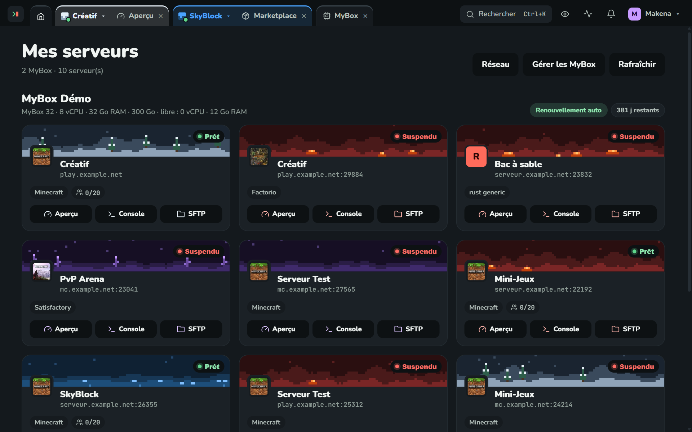<br/><sub>Accueil — chaque serveur a son biome</sub></td>
    <td width="50%">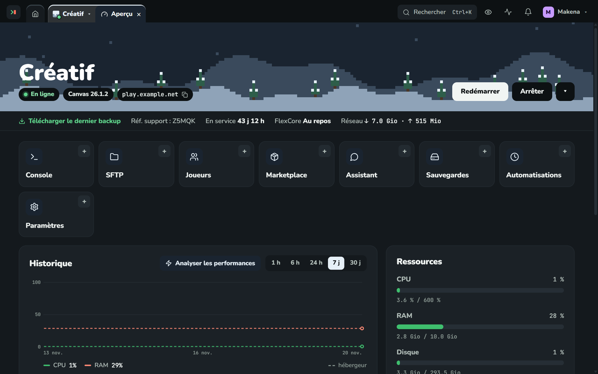<br/><sub>Tableau de bord d'un serveur</sub></td>
  </tr>
  <tr>
    <td width="50%">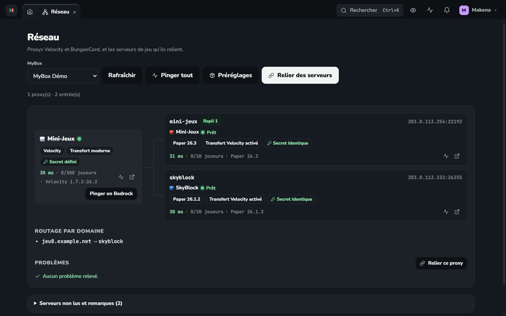<br/><sub>Réseau : proxy Velocity relié, ping et transfert vérifiés</sub></td>
    <td width="50%">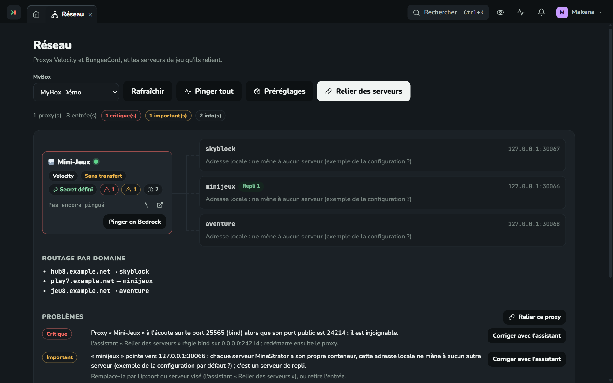<br/><sub>Problèmes détectés, avec leur correction</sub></td>
  </tr>
  <tr>
    <td width="50%">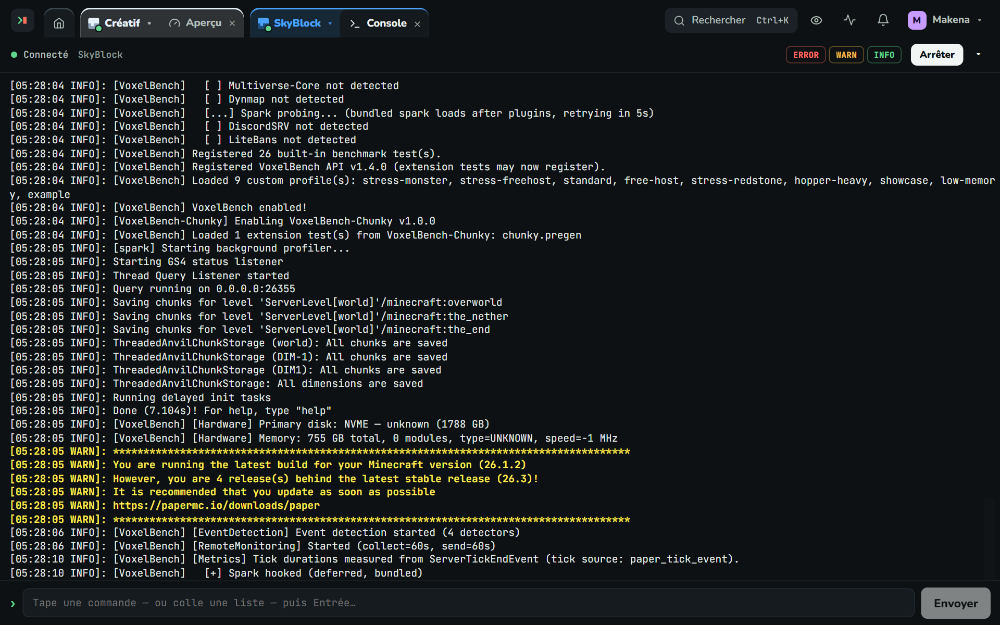<br/><sub>Console temps réel, filtres par niveau</sub></td>
    <td width="50%">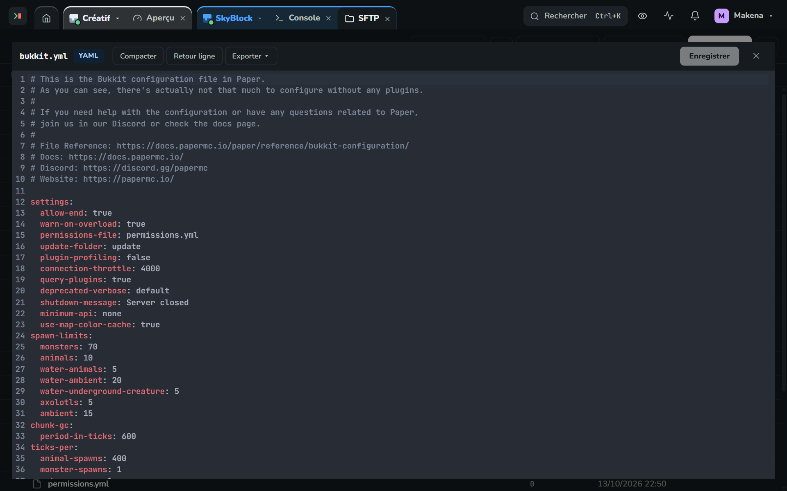<br/><sub>Fichiers SFTP et éditeur intégré</sub></td>
  </tr>
  <tr>
    <td width="50%">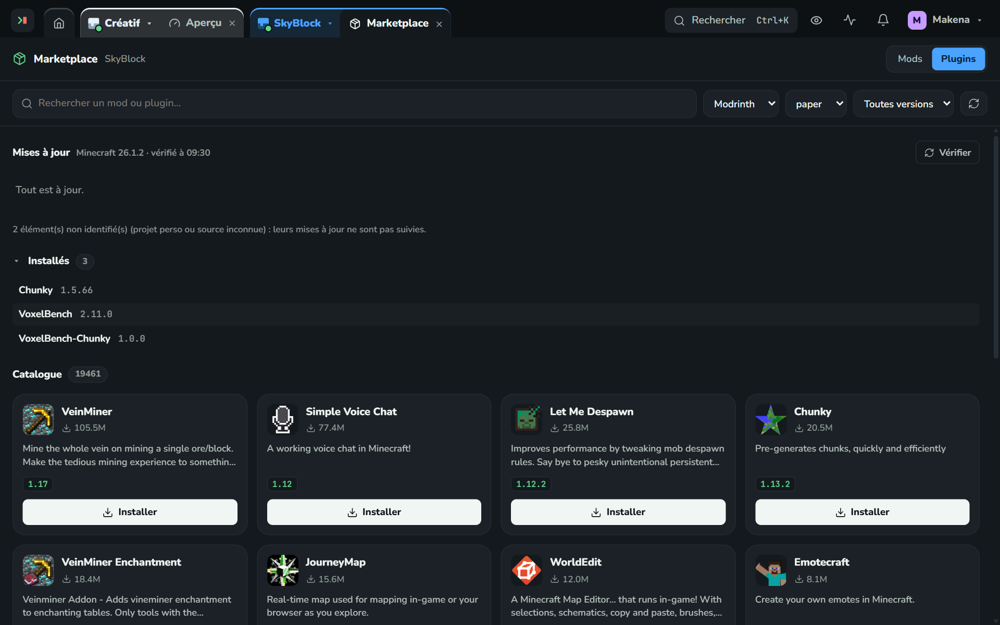<br/><sub>Marketplace et mises à jour des plugins</sub></td>
    <td width="50%">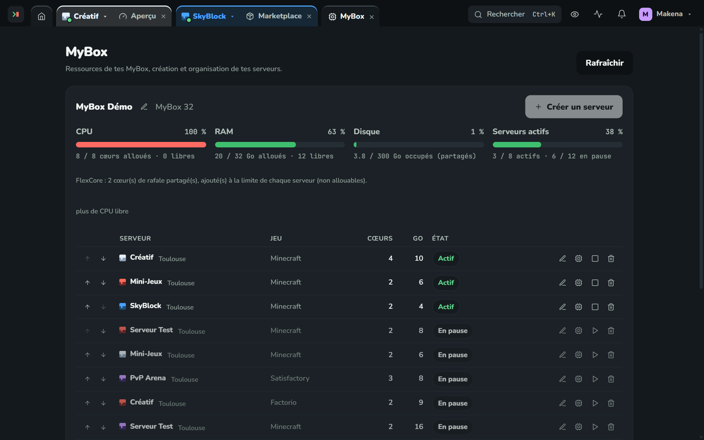<br/><sub>Gestion des MyBox : ressources et serveurs</sub></td>
  </tr>
</table>

### 📱 Mobile — Android

<p align="center">
  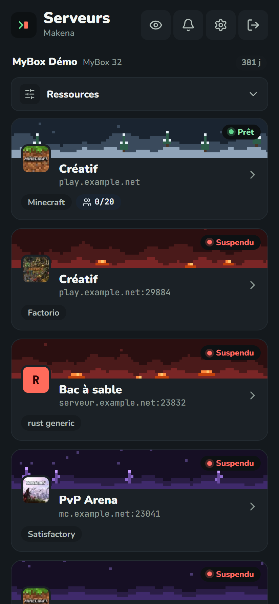&nbsp;
  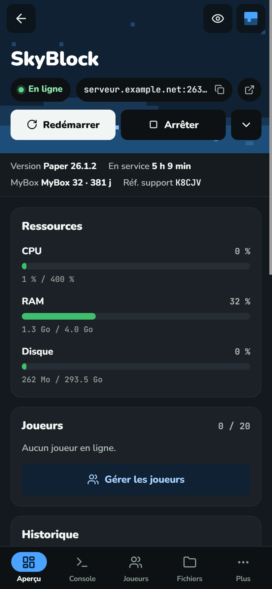&nbsp;
  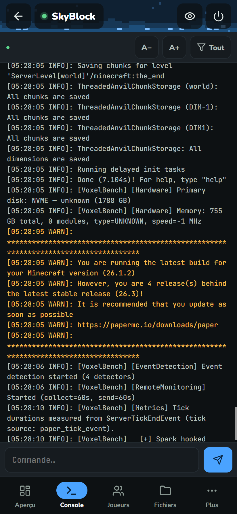&nbsp;
  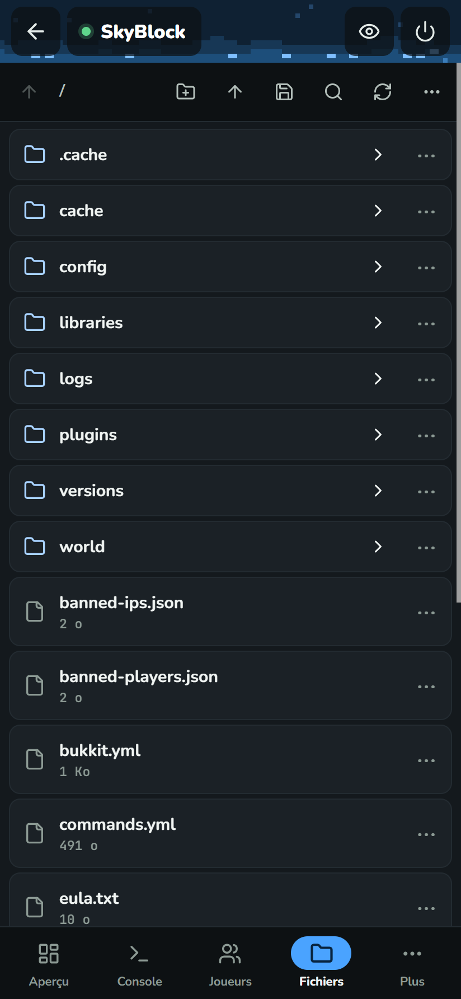&nbsp;
  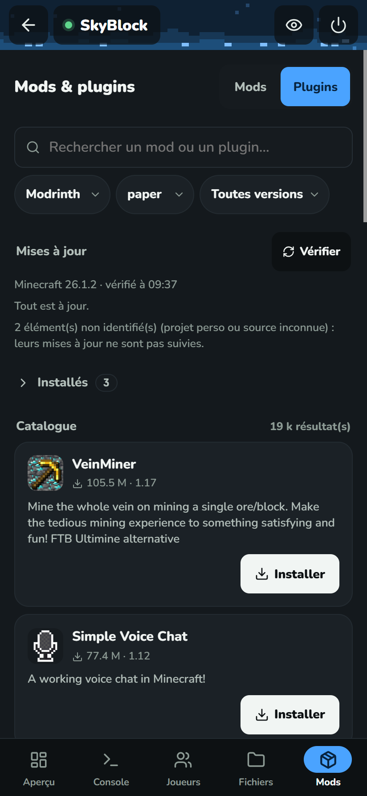&nbsp;
  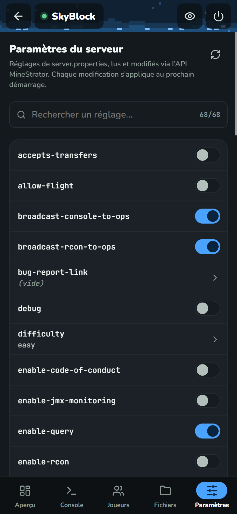
</p>

> Captures prises en mode « données de démo » : noms de serveurs, adresses et pseudos sont fictifs.

---

## ✨ Fonctionnalités

### 🎮 Pilotage & console
- **Console temps réel** (xterm.js) via WebSocket (protocole Pterodactyl Wings) : logs live, **filtres par niveau** (ERROR/WARN/INFO), **autocomplétion** des commandes, envoi avec historique, copie de la sélection.
- **Envoi multi-ligne** : colle une liste de commandes → chaque ligne part comme **commande séparée**, dans l'ordre.
- **Export du log** d'un clic droit vers un service de paste : **mclo.gs**, l'instance **MineStrator** ou **pastes.dev** (contenu anonymisé avant envoi).
- **Tableau de bord** par serveur : état, adresse, alimentation (démarrer · redémarrer · arrêter · kill), ressources, **historique jusqu'à 30 jours** (relayé par les statistiques de l'hébergeur quand l'ordinateur était éteint), joueurs connectés et **disponibilité** sur 24 h / 7 j / 30 j.
- **Paramètres du serveur** (`server.properties`) via l'API, valeurs secrètes masquées.

### 👥 Joueurs
- Kick, ban/unban, op, whitelist — y compris sur des pseudos hors ligne.
- **Tous les joueurs déjà venus** (Minecraft Java) : temps de jeu, dernière venue, recherche, tri, statistiques (actifs sur 7 et 30 jours, meilleurs temps de jeu), fiche détaillée et **inventaire illustré**.

### 📁 SFTP natif intégré (russh) — un vrai gestionnaire de fichiers
- Explorateur avec colonnes triables, **glisser-déposer** pour l'upload, **sélection multiple**.
- **Éditeur intégré** (CodeMirror) : coloration JSON/YAML/TOML/Java/Properties/Shell/…, **recherche dans le fichier** (Ctrl+F), formatage/minification JSON.
- **Téléchargement** d'un fichier, ou d'un dossier / d'une sélection **en `.zip`** préparé par le serveur, rapatrié avec reprise.
- **Compression et extraction faites par le serveur** : sauvegarder un monde en `.zip` sur place, extraire une archive (`.zip`, `.tar.*`, `.7z`, `.rar`, `.mcworld`…) sans rien faire transiter par l'appareil.
- **Espace disque** : ce qui occupe le plus de place, dossier par dossier, face à la limite du serveur et de la MyBox.
- **Gestionnaire de transferts** : progression, envois et téléchargements suivis en parallèle.
- **Archives** en lecture seule, **aperçu d'images**, export des fichiers texte vers un paste.
- Identité du serveur SFTP **vérifiée à chaque connexion** : l'app prévient si elle change.

### 🧊 Inspecteur NBT & mondes (façon NBTExplorer)
- `.dat` / `.nbt` / `.schem` → **arbre typé repliable** qui **préserve le type NBT** exact, **recherche**, **hints parlants** (UUID, dates, coordonnées, booléens), **vue et copie en SNBT** (`/data`).
- `.mca` → **carte 32×32 des chunks** (présence / taille / corruption en heatmap), **aller à une coordonnée**, arbre NBT d'un chunk, **rapport de corruption** + réparation.

### 📦 Mods, plugins & sauvegardes
- **Marketplace multi-jeux**, adaptée automatiquement au jeu du serveur :
  - **Minecraft** — Modrinth / CurseForge / SpigotMC : choix de version, installation en un clic.
  - **Satisfactory** — ficsit.app (SMR) : résout SML + dépendances, active / désactive / supprime.
  - **Factorio** — Mod Portal officiel : installation authentifiée, dépendances requises, `mod-list.json`.
  - **Valheim / V Rising** (Thunderstore) & **Rust** (uMod) — catalogue et versions *(installation à venir)*.
  - **Panier** : plusieurs mods installés en **un seul lot**, avec un seul redémarrage.
- **Mises à jour signalées** pour les mods, plugins et datapacks : un élément ou tout d'un coup ; une version prévue pour une autre plateforme n'est jamais proposée.
- **Sauvegardes** : backups quotidiens de l'hébergeur (restaurables) + **snapshots** à la demande.

### 🗄️ MyBox
- **Ressources de chaque MyBox** (cœurs, mémoire, disque, serveurs actifs) et **création de serveurs** (catalogue des jeux, limité à ce qui reste disponible, MyBox suggérée).
- Redimensionner, renommer, réordonner, mettre en pause ou supprimer un serveur — sauvegarde proposée et nom à retaper avant suppression.

### 🌐 Réseaux proxy Velocity / BungeeCord
- **Vue « Réseau »** : le proxy de chaque MyBox et ses serveurs de jeu en schéma, avec état, ping et **problèmes détectés** accompagnés d'un conseil (serveur non déclaré, mode de transfert incohérent, proxy à l'écoute sur le mauvais port…).
- **Assistant « Relier des serveurs »** : ordre de connexion, liste de repli, mode de transfert des joueurs, **routage par nom de domaine**, nettoyage des entrées d'exemple. Changements simulés et montrés avant d'être appliqués, snapshot possible, **annulables**.
- **Préréglages** LuckPerms (permissions partagées sur une même base, synchronisées instantanément) et Geyser (joueurs Bedrock).

### 🩺 Supervision, alertes & automatisations
- **Superviseur** en tâche de fond (fenêtre fermée, l'app reste dans le tray) : crash, seuils CPU/RAM/disque, échéance des MyBox → **notifications natives**, centre d'alertes.
- **Service d'arrière-plan** optionnel (Windows, Linux, macOS) : la supervision continue **même application fermée** ou session déconnectée. Voir [`docs/SERVICE.md`](./docs/SERVICE.md).
- **Redémarrage automatique** après un crash, **tâches planifiées** exécutées par l'app (redémarrage annoncé aux joueurs, snapshot, commandes) et **tâches du panel MineStrator**, exécutées par l'hébergeur même ordinateur éteint.
- **Alertes Discord et webhooks**, anonymisées.

### 🤖 Copilote IA
- Diagnostic **automatique** (crash, surcharge prolongée) et **assistant conversationnel** par serveur.
- **Multi-fournisseur** : Anthropic (Claude) et tout service compatible OpenAI (GPT, Gemini, Mistral, Groq, DeepSeek, OpenRouter, Ollama / LM Studio locaux…).
- **Agents CLI** : Claude Code, OpenCode, Gemini CLI, avec l'abonnement déjà configuré sur la machine (**sans clé API**), privés de shell et d'accès au disque.
- Outils de réparation : **docteur démarrage** (crash-loop), **maps corrompues** (`.mca`), **analyse de performance** (Spark).
- **Cloisonné** : il n'agit que sur le serveur de la conversation et ne touche jamais aux fichiers de l'ordinateur ; en mode autonome, il ne peut ni supprimer, ni restaurer, ni gérer l'infrastructure.

### 🔌 Serveur MCP pour vos agents IA
Un **serveur MCP intégré** ([Model Context Protocol](https://modelcontextprotocol.io)) expose **107 outils** à n'importe quel client MCP (Claude Desktop, Claude Code, Cline…), plus jusqu'à 65 outils du **MCP officiel MineStrator** relayés sur option. Détails : [`MCP.md`](./MCP.md).
- **Piloter et vérifier** : console suivie en direct, commande envoyée avec sa réponse, attente du démarrage, déploiement d'un plugin puis vérification qu'il s'est chargé.
- **Configurer sans casser** : modification ciblée des configs YAML / TOML / JSON / properties (commentaires et mise en forme conservés), manifeste complet d'un serveur pour le reproduire, copie de test d'un serveur.
- **Monter un réseau entier depuis un seul fichier** : proxy, serveurs, plateformes, plugins, configs ; simulé, appliqué, relançable sans rien refaire.
- **Depuis l'ordinateur** : jars, dossiers de configuration et mondes envoyés directement ; une même action sur plusieurs serveurs.
- **Garde-fous** : écritures **désactivées par défaut**, journal de chaque appel, modifications d'un agent **annulables d'un bouton**, mode « constructeur » qui limite les écritures aux serveurs autorisés, confirmation humaine avant une action destructive.
- **Secrets par référence** : un token ou un mot de passe rangé dans le trousseau est écrit sur le serveur sans que l'agent ne voie jamais sa valeur.

### ⚙️ Confort & sécurité
- **Apparence « Biome »** : chaque serveur a son biome (forêt, océan, désert, neige, Nether, End) qui colore ses onglets et l'en-tête de son tableau de bord.
- **Mode anonyme** (Ctrl+Maj+H) : masque IP, adresses, hôte SFTP et e-mail du compte pour vos captures d'écran.
- **Palette de commandes** (Ctrl+K) : aller à un serveur, ouvrir une vue, lancer une action.
- **Plusieurs comptes MineStrator**, sans ressaisir de clé.
- Onglets regroupés par serveur, **fenêtres détachées**, tray, thème clair/sombre, **français / anglais**.
- **Mise à jour automatique** signée (desktop) ou par APK (Android).
- **Confidentialité** : la clé API et tous les identifiants vivent dans le trousseau de l'OS (Keystore sur Android) ; anonymisation (mots de passe, IP, e-mails, secrets) avant tout envoi à une IA, un paste ou un webhook.
- **Adaptation par jeu** (Minecraft Java/Bedrock, Satisfactory, Factorio, Valheim, Rust…) : vues, autocomplétion, coloration de la console et outils du Copilote ajustés.

### 📱 Application Android
Même cœur que le desktop, interface tactile : liste des serveurs par MyBox, aperçu avec jauges et historique, console, joueurs, fichiers, sauvegardes, mods et plugins, paramètres du serveur, centre d'alertes et notifications de l'hébergeur, plusieurs comptes. Une **surveillance en arrière-plan** continue d'alerter application fermée. Détails : [`mobile/README.md`](./mobile/README.md).

---

## 📦 Installation

Télécharge le dernier installeur depuis la page **[Releases](../../releases/latest)** :

| OS | Fichier |
|---|---|
| Windows | `.exe` (NSIS) ou `.msi`, ou `_x64-portable.zip` (portable : à décompresser, sans installation) |
| macOS | `.dmg` (universel Intel + Apple Silicon) |
| Linux | `.AppImage`, `.deb` ou `.rpm` |
| Android | `_android.apk` (presque tous les téléphones, 64 bits) ou `_android-armv7.apk` (anciens téléphones 32 bits) |

Au premier démarrage, saisis ta **clé API MineStrator** (Panel → Compte → Clés API) — elle est validée puis stockée dans le trousseau de l'OS.

Une fois installée, l'app **se met à jour toute seule** : elle propose les nouvelles versions au démarrage (désactivable dans les Réglages). Sur Android, l'APK qui correspond au téléphone se télécharge et s'installe depuis l'application. La version portable signale les nouvelles versions et ouvre la page de téléchargement ; le service d'arrière-plan n'est disponible qu'avec l'installeur.

> Les binaires ne sont **pas signés au niveau OS** : Windows SmartScreen / macOS Gatekeeper peuvent afficher un avertissement au premier lancement. Les **artefacts de mise à jour**, eux, sont signés et vérifiés (voir [`docs/AUTO-UPDATE.md`](./docs/AUTO-UPDATE.md)).

---

## 🏗️ Architecture

Monorepo **Cargo workspace** qui **sépare strictement la logique métier de l'UI** : le cœur ne connaît aucune interface, et le serveur MCP comme le service d'arrière-plan l'utilisent tel quel.

```
crates/
  minestrator-core/   Logique métier UI-agnostique : client API, WebSocket, SFTP,
                      NBT/.mca, superviseur, Copilote (LLM + agents CLI), serveur MCP.
  minestrator-mcp/    Serveur MCP autonome (headless), bâti sur le core.
  minestrator-daemon/ Service d'arrière-plan Windows/Linux/macOS : supervision app fermée,
                      alertes, push FCM (voir docs/SERVICE.md).
desktop/              App desktop Tauri (Windows/macOS/Linux) :
  src-tauri/          couche d'adaptation : commandes IPC, tray, pont d'events, notifications.
  src/                Frontend SvelteKit / Svelte 5 (runes) + TypeScript.
mobile/               App mobile Tauri (Android) — même core, UI tactile propre.
docs/                 Documentation additionnelle.
```

- **Stack** : Tauri 2 · Rust · SvelteKit · Svelte 5 · TypeScript.
- **Desktop et mobile partagent `crates/minestrator-core`** : chaque frontend n'est qu'une mince couche par-dessus le même cœur (le réseau vit en Rust, cf. contrainte `Origin` du WebSocket).
- **Tout le réseau** (HTTP, WebSocket, SFTP, uploads paste) vit **côté Rust** ; le front ne parle qu'à une couche IPC typée (`desktop/src/lib/ipc.ts`).

---

## 🚀 Développement

### Prérequis
- [Rust](https://rustup.rs) (stable) + les [prérequis Tauri](https://v2.tauri.app/start/prerequisites/) de ta plateforme (Windows : MSVC Build Tools + WebView2 ; Linux : `webkit2gtk`, `librsvg`, etc.).
- [Node.js](https://nodejs.org) 22.17+ (LTS 24 recommandée ; exigé par SvelteKit 3) et npm.

### Lancer en développement
Les commandes **frontend** se lancent depuis `desktop/` (le projet npm y vit désormais) ;
les commandes **Cargo** depuis la racine (le workspace couvre tout le monorepo).
```bash
cd desktop
npm install          # dépendances frontend
npm run tauri dev    # app desktop en dev (hot-reload du front)
```

Application Android (depuis `mobile/`, `ANDROID_HOME` et `NDK_HOME` requis) :
```bash
npx tauri android dev                    # émulateur ou appareil branché
npx tauri android build --apk --debug    # APK de debug
```

### Autres commandes
```bash
# Depuis desktop/ :
npm run check                             # typecheck (svelte-check)
npm run build                             # build du frontend seul → desktop/build/
npm run tauri build                       # app packagée (installeurs)

# Depuis la racine (workspace) :
cargo test -p minestrator-core            # tests du cœur métier
cargo clippy --workspace --all-targets    # lint
cargo build -p minestrator-mcp --release  # binaire serveur MCP autonome
```

### Publier une release
1. Ajouter l'entrée `## vX.Y.Z` en tête de [`CHANGELOG.md`](./CHANGELOG.md) : elle devient le corps de la release.
2. Mettre la même version dans les 5 fichiers : `Cargo.toml` (racine), `desktop/package.json`, `desktop/src-tauri/tauri.conf.json`, `mobile/package.json`, `mobile/src-tauri/tauri.conf.json`.
3. Pousser un tag :
```bash
git tag vX.Y.Z && git push origin vX.Y.Z
```
GitHub Actions ([`release.yml`](./.github/workflows/release.yml)) build les trois OS et l'APK Android signé, **signe** les artefacts de mise à jour, génère `latest.json` et crée une release *draft*, à publier pour qu'elle soit proposée aux clients. Détails : [`docs/AUTO-UPDATE.md`](./docs/AUTO-UPDATE.md).

---

## 📚 Documentation

| Doc | Contenu |
|---|---|
| [`ARCHITECTURE.md`](./ARCHITECTURE.md) | Couches, modules du cœur, catalogue IPC et events, faits d'API |
| [`DESIGN.md`](./DESIGN.md) | Charte graphique / design system |
| [`COPILOT.md`](./COPILOT.md) | Fonctionnement du Copilote IA |
| [`MCP.md`](./MCP.md) | Serveur MCP : catalogue d'outils, sécurité, connexion |
| [`docs/SERVICE.md`](./docs/SERVICE.md) | Service d'arrière-plan : installation, secrets machine, IPC |
| [`docs/AUTO-UPDATE.md`](./docs/AUTO-UPDATE.md) | Mise à jour automatique : signature, endpoint, publication |
| [`docs/PUSH.md`](./docs/PUSH.md) | Notifications push mobile (FCM) |
| [`docs/api/REFERENCE.md`](./docs/api/REFERENCE.md) | API MineStrator complète, documentée ou non |
| [`mobile/README.md`](./mobile/README.md) | Application Android : build, signature, périmètre |
| [`CHANGELOG.md`](./CHANGELOG.md) | Notes de chaque version |
| [`ROADMAP.md`](./ROADMAP.md) | Ce qui est livré, à finir, et le backlog |
| [`docs/history/ARCHITECTURE-V1.md`](./docs/history/ARCHITECTURE-V1.md) | Spec fondatrice V1 (historique) |

---

## 📄 Licence

[GNU GPL v3.0 ou ultérieure](./LICENSE) © Geoffrey Lecoq

Logiciel libre : vous pouvez l'utiliser, l'étudier, le modifier et le redistribuer, à condition que
tout dérivé distribué reste sous licence GPL (copyleft).

> Non affilié à MineStrator — client tiers utilisant leur API publique.
